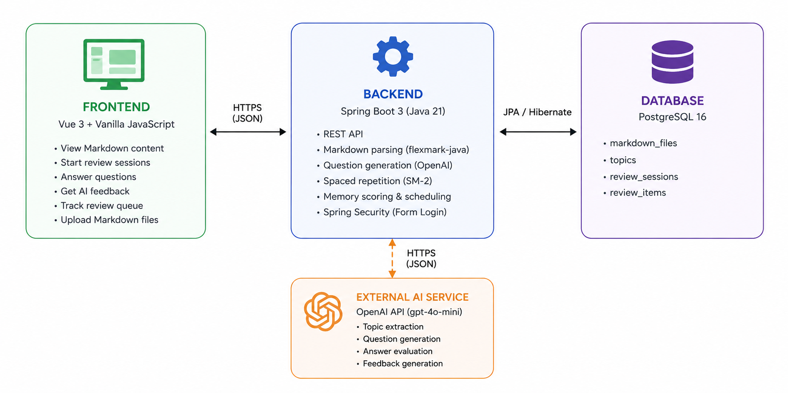
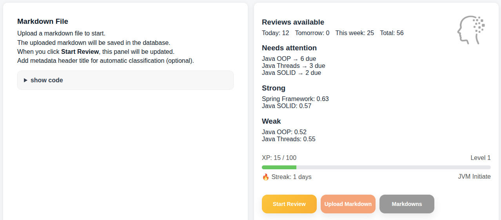

# Recall Forge

The application import topics from a local README.md, ask review questions,  
evaluates answers with OpenAI, and stores memory in database.  

## 1. Backend-only
v1.0.1

- 1.1 Project structure
- 1.2 Gradle Settings 
- 1.3 Gradle Build
- 1.4 Docker Compose
- 1.5 OpenAPI 
- 1.6 Application Properties
- 1.7 Main App
- 1.8 Domain model (JPA)
- 1.9 Repositories
- 1.10 DTOs
- 1.11 OpenAI Config
- 1.12 Services
- 1.13 Controllers
- 1.14 Run the project
- 1.15 Api Requests

## 2. Repetition System
v1.0.2

- 2.1 Review History Endpoint
- 2.2 Due Topics Endpoint
- 2.3 Test it
- 2.4 Dashboard
- 2.5 Upload markdown file
- 2.6 Database clear
- 2.7 Due topics
- 2.8 Categories
- 2.9 Database backup
- 2.10 Queue Summary

## 3. Dashboard
v1.0.3

- 3.1 Improved Summary
- 3.2 Dashboard Graphics
- 3.3 Subdomain with Traefix
- 3.4 Markdowns Summary

## 4. Reward Layer
v1.0.4

- 4.1 XP points
- 4.2 Perfect streak bonus
- 4.3 Reward bar
- 4.4 Level title

## 5. OAuth2
v1.0.5

- 5.1 Add oauth2 dependency
- 5.2 Modify SecurityConfig.java
- 5.3 Povider setup (googl, github)
- 5.4 Database integration
- 5.5 App user integration
- 5.7 Demo layout

## 6. Unit Testing (with Claude)

- 6.1 Claude Code
- 6.2 Create account
- 6.3 Install Claude Code
- 6.4 First safe task
- 6.5. Instruction files
- 6.6 Recommended structure
- 6.7 Claude Usage

## 7. Users

- 7.1 Users list (admin)
- 7.2 Category aware (dashboard)
- 7.3 Danger zone (reset learning)
- 7.4 Starter pack
- 7.5 Tokens limits (logs)

## 8. Content

- 8.1 Markdown edit
- 8.2 Markdown reset reviews or delete
- 8.3 Subcategories and categories order
- 8.4 Claude content authoring instructions
- 8.5 Content author subagent
- 8.6 Agent Git safety
- 8.7 Login disabled
- 8.9 Daily reviews limit

### 9. Tokens

- 9.1 Difficutly aware questions
- 9.2 User tokens spent
- 9.3 Daily caps (reviews and questions, per category)
- 9.4 Skip today & Shortcuts
- 9.5 Manual topic selection
- 9.6 Skip button
- 9.7 Docker Hub setup
- 9.8 Markdown Optimize

## Architecture

## Screenshots

